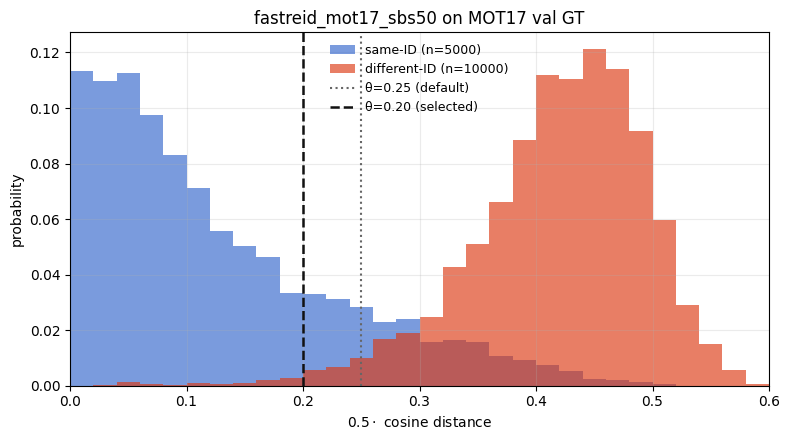
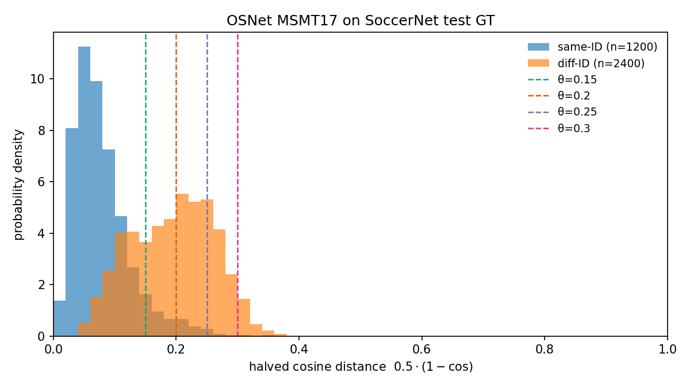
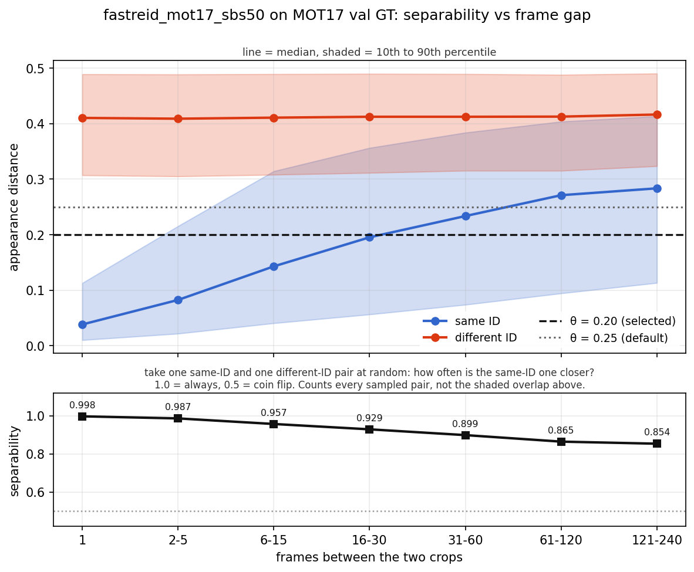
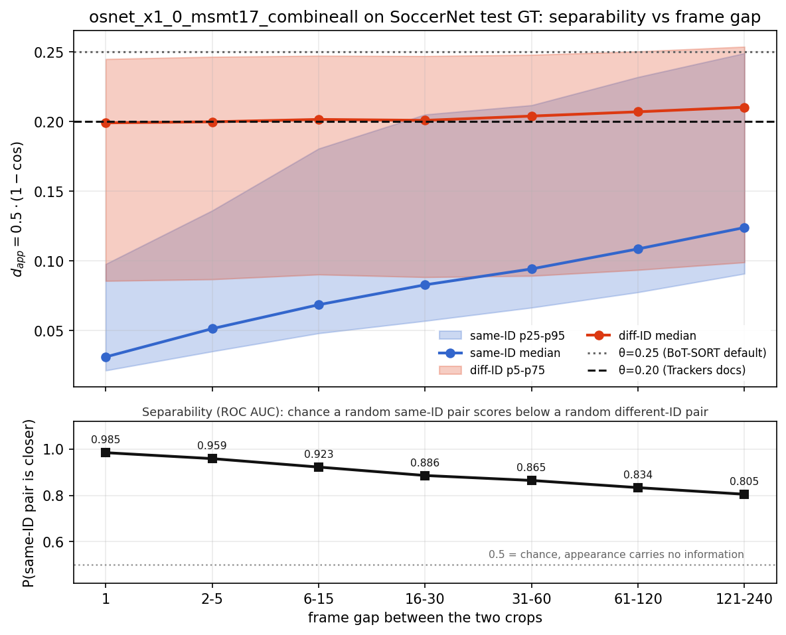

# ReID Appearance

BoT-SORT can fuse appearance embeddings with IoU during association. Embeddings come from a model in the standalone [`reid`](https://github.com/roboflow/re-ID) package. See the [ReID API](../api/reid.md) for the association helpers.

**What you'll learn:**

- How to enable appearance association on BoT-SORT
- Which parameters control the appearance gate
- How to pick `reid_appearance_threshold` for your encoder and domain
- What ReID changes on MOT17 and SoccerNet

---

## Install

```bash
pip install "trackers[reid]"
```

The `reid` extra installs the [`reid`](https://github.com/roboflow/re-ID) package, which loads the encoders and brings PyTorch with it. To combine it with other extras, such as `detection` for running a detector from the CLI, or to install with `uv`, see the [install guide](install.md#reid-bot-sort-appearance).

---

## Quickstart

=== "Python"

    ```python
    from reid import ReIDModel

    from trackers import BoTSORTTracker

    reid_model = ReIDModel.from_pretrained("fastreid_mot17_sbs50")
    tracker = BoTSORTTracker(reid_model=reid_model, reid_appearance_threshold=0.2)
    ```

=== "CLI"

    `--reid.model` takes a curated alias, an `hf://` URL, or a local path, and enables appearance association on its own. Tracker parameters keep their Python names, so the appearance gate is `--tracker.reid_appearance_threshold`. See the [CLI reference](cli.md) for every argument.

    ```bash
    trackers track \
        --source <SOURCE_VIDEO_PATH> \
        --tracker botsort \
        --reid.model fastreid_mot17_sbs50 \
        --tracker.reid_appearance_threshold 0.2 \
        --output.video output.mp4
    ```

!!! warning "A frame is required when ReID is enabled"

    Pass the current video frame as `tracker.update(detections, frame=frame_bgr)`. When `reid_model` is set, `update()` raises if `frame` is omitted.

For the model catalog and fine-tuning, see the [`reid` training guide](https://github.com/roboflow/re-ID/blob/main/docs/learn/train.md).

---

## Key Parameters

| Parameter                   | Purpose                                                                                                            | Tuning guidance                                                                                                  |
| --------------------------- | ------------------------------------------------------------------------------------------------------------------ | ---------------------------------------------------------------------------------------------------------------- |
| `reid_model`                | Appearance encoder queried during association.                                                                     | Leave unset for IoU and CMC only. Pick a checkpoint trained on your object domain where possible.                |
| `reid_ema_alpha`            | EMA momentum for a track's appearance feature.                                                                     | Default 0.9. Higher keeps a stable long-term identity; lower adapts faster to appearance change but drifts more. |
| `reid_appearance_threshold` | Maximum appearance distance `d_app` for appearance to lower a pair's matching cost.                                | BoT-SORT paper default 0.25. Calibrate per encoder and domain, see below.                                        |
| `reid_proximity_threshold`  | IoU gate applied before appearance (`IoU ≥ 1 - reid_proximity_threshold`), from true IoU even with GIoU/DIoU/CIoU. | Default 0.5. Lower restricts how far apart a pair may be before appearance stops contributing.                   |

---

## Choosing an appearance threshold

BoT-SORT fuses costs as `min(d_iou, d_app)` with `d_app = 0.5 * (1 - cos_sim)`, and discards the appearance term when `d_app` exceeds `reid_appearance_threshold` (paper default 0.25) or when the pair fails the `reid_proximity_threshold` IoU gate. Appearance can therefore only lower a pair's cost, never veto a geometric match. Pick $\theta$ on a labeled split with the encoder you will track with:

1. Embed GT crops.
2. Histogram `d_app` for association-local pairs: same video only, with frame gap bounded by the lost-track horizon (default 30 frames). Positives are same-ID; negatives are different-ID that could co-compete. Sample both classes with the same per-sequence quota, otherwise one crowded sequence decides the answer.
3. Choose $\theta$ so most same-ID pairs fall below it and most different-ID pairs fall above it.

All three steps ship with Trackers, so you can run them on your own footage. `extract_ground_truth_embeddings` reads any MOT-format dataset, meaning a `gt/gt.txt` and an `img1` folder per sequence, and returns each crop's embedding alongside the identity, frame and sequence it came from:

```python
from trackers.core.reid import (
    extract_ground_truth_embeddings,
    plot_appearance_distances,
    sample_appearance_distances,
)

embeddings, ids, frame_ids, sequence_ids = extract_ground_truth_embeddings(model, "mot17/val", keep_classes=(1,))
distances = sample_appearance_distances(embeddings, ids, frame_ids, sequence_ids)
for threshold in (0.10, 0.20, 0.25):
    same_id_rate, different_id_rate = distances.rates_at(threshold)
    print(f"θ={threshold:.2f}: same-ID {same_id_rate:.1%}, different-ID {different_id_rate:.1%}")

plot_appearance_distances(distances, thresholds={0.20: "selected", 0.25: "default"})
```

See the [ReID API reference](../api/reid.md#choosing-a-threshold) for the full signatures. The figures on this page were produced with these helpers on MOT17 val and SoccerNet test ground truth. To reproduce them end to end, from download to calibrated threshold, open the [ReID cookbook](https://colab.research.google.com/github/roboflow/trackers/blob/develop/docs/cookbooks/how-to-add-reid-to-trackers.ipynb) in Colab.

**MOT17 val, `fastreid_mot17_sbs50`.** Same-ID distances peak near 0 and different-ID near 0.4. On association-local GT crop pairs (5000 same-ID, 10000 different-ID, frame gap 1 to 30), $\theta = 0.2$ keeps 68% of same-ID pairs while passing 1.1% of different-ID pairs. Raising $\theta$ to the BoT-SORT default 0.25 recovers same-ID pairs (79%) but nearly triples the different-ID pairs it admits (2.9%), which is why 0.2 is the better operating point here ([MOT17 re-ID study](https://www-sop.inria.fr/members/Francois.Bremond/Postscript/Tomasz__SCCAI_2025.pdf) Table 8 uses the same threshold).



**SoccerNet test, `osnet_x1_0_msmt17_combineall`.** A pedestrian encoder on soccer footage squeezes every distance into a narrow range: same-ID pairs peak near 0.05 and different-ID pairs near 0.20 (similar kits). The two shapes still separate, but the scale no longer matches the thresholds BoT-SORT was tuned with. On association-local GT crop pairs (5000 same-ID, 10000 different-ID, frame gap 1 to 30), $\theta = 0.2$ admits 96% of same-ID pairs but also 49% of different-ID pairs, and tracking stays flat against CMC-only. $\theta = 0.1$ holds different-ID pairs to 9%, yet appearance still assists a mix of correct and same-kit pairs and costs HOTA and IDF1 (see the SoccerNet table below). Calibrate $\theta$ on your own domain rather than carrying 0.2 or 0.25 across.



---

## How far the threshold carries

To choose `lost_track_buffer`, it helps to see how Re-ID behaves as the frame gap grows. A player's encoded appearance can change over time, so `sweep_frame_gap` samples labeled crop pairs across widening gap bands. It does not simulate dropped frames or occlusions. Plot the results with `plot_frame_gap_sweep`:

```python
from trackers.core.reid import plot_frame_gap_sweep, sweep_frame_gap

sweep = sweep_frame_gap(embeddings, ids, frame_ids, sequence_ids)
plot_frame_gap_sweep(sweep, thresholds={0.20: "selected", 0.25: "default"})
```

On MOT17 val, the typical appearance difference between two different people stays near 0.41 even at gaps up to 240 frames. For the same person, it grows from 0.04 one frame apart to 0.20 at 16 to 30 frames and 0.28 at 121 to 240 frames. Smaller values mean the crops look more alike, so matching the same person gets harder as the gap grows.

ROC AUC shows how well the encoder separates same-ID from different-ID pairs across all thresholds: 1.0 is perfect separation, while 0.5 is no better than chance. The shaded bands in the plot show where most pair scores fall; AUC uses every pair. The last two columns show the share of each group accepted at the 0.2 threshold.

| Frame gap  | ROC AUC | same-ID below 0.2 | different-ID below 0.2 |
| :--------- | :-----: | :---------------: | :--------------------: |
| 1          |  0.998  |       98.0%       |          1.7%          |
| 2 to 5     |  0.987  |       87.6%       |          1.6%          |
| 6 to 15    |  0.957  |       67.4%       |          1.1%          |
| 16 to 30   |  0.929  |       51.4%       |          1.1%          |
| 31 to 60   |  0.899  |       39.8%       |          0.9%          |
| 61 to 120  |  0.865  |       31.8%       |          0.8%          |
| 121 to 240 |  0.854  |       28.7%       |          0.8%          |



Two things follow. First, a threshold validated on adjacent frames says little about re-association: at $\theta = 0.2$ appearance helps 98% of same-ID pairs one frame apart but only 51% across the default 30-frame lost-track buffer. Second, the price of a tight $\theta$ over long gaps is missed re-associations rather than extra wrong ones, because the different-ID rate stays near 1% throughout. If you raise `lost_track_buffer` to recover tracks after long occlusions, raise `reid_appearance_threshold` with it and re-check the different-ID column.

The cross-domain encoder fails differently. On SoccerNet the different-ID rate at $\theta = 0.2$ stays between 44% and 51% at every gap, so the frame gap is not what limits it; the encoder simply cannot separate players in matching kits at any horizon. Widening the gap costs same-ID pairs (99.6% down to 87.0%) without ever making the different-ID side usable, which is why $\theta$ has to come down to about 0.1 on this domain instead of being traded against the gap.


